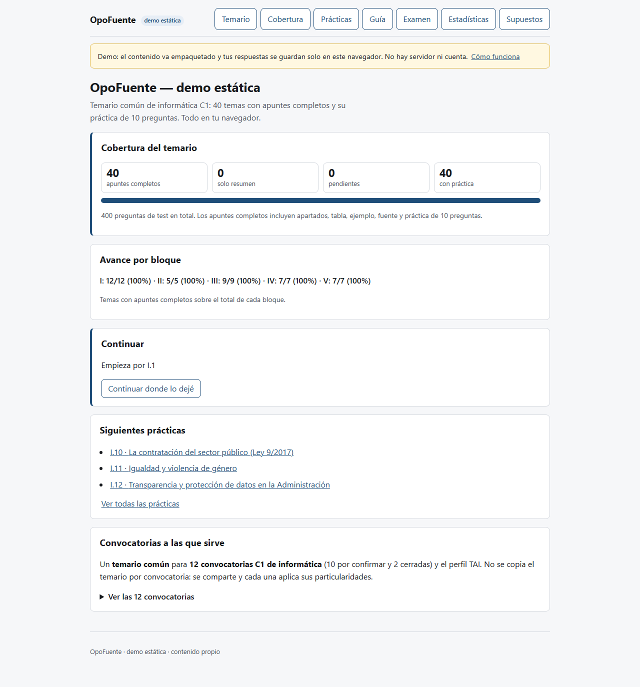

# Portafolio — OpoFuente (demo de temario y práctica)

**Estado: ✅ Funcional y demostrable.** Cumple el criterio de entrada: está publicado, se puede usar
de principio a fin y hay evidencia reproducible (capturas, comprobaciones automáticas y enlace
público). No es una maqueta.

- **Enlace público:** <https://erdeivih.github.io/opofuente-demo/>
- **Mapa de cobertura:** <https://erdeivih.github.io/opofuente-demo/#/cobertura>
- **Repositorio:** `F:\Proyectos\opofuente` (privado). La demo se publica desde el repositorio
  público `ErDeivih/opofuente-demo`, que contiene **solo el build**.
- **Fecha de esta ficha:** 10/11/2026.

## 1. Problema que resuelve

Preparar una oposición de informática C1 es estudiar un temario común de **40 temas** repartido entre
leyes, sistemas, redes y seguridad, con convocatorias distintas que comparten casi todo el programa.
El opositor se enfrenta a tres problemas prácticos:

1. **No sabe qué le falta**: el material está disperso en PDFs, apuntes y tests, sin un mapa de
   cobertura claro.
2. **Estudiar no es practicar**: necesita pasar del apunte a preguntas tipo test con corrección y
   explicación.
3. **La información oficial está fuera del apunte**: cuando una pregunta cita un artículo, hay que
   poder abrir el texto consolidado del BOE.

OpoFuente convierte ese material en un producto local-first y publica una **demo estática** que
permite recorrer la cobertura, estudiar los temas redactados y hacer su práctica sin cuenta ni
servidor.

## 2. Qué demuestra

### Contenido

- **40 de 40 temas** con apuntes completos de redacción propia: apartados, definiciones, tablas,
  ejemplos resueltos y fuente oficial (BOE, TUE/TFUE, RFC, ISO, NIST).
- **40 prácticas de 10 preguntas** (400 preguntas base) y **5 casos prácticos** (50 preguntas) con
  respuesta razonada y enlace al texto oficial cuando se cita un artículo.
- **Temario completo**: 0 pendientes y 0 solo resumen; los 40 temas están publicados.
- **Calidad revisada**: 40/40 fichas con «Lo que hay que memorizar» y «Errores típicos»; 5 temas
  reforzados (II.15, II.16, II.17, III.18, III.22) y letra correcta equilibrada (100 a/b/c/d).
  Detalle en [CALIDAD-TEMARIO.md](docs/CALIDAD-TEMARIO.md).
- **Temas largos**: I.1, III.21, IV.27, V.34 y V.35 reescritos con 2.488-3.064 palabras, 70 casos
  tipo test y 3 SVG propios; fuentes citadas y páginas de estudio autosuficientes. Detalle en
  [TEMAS-LARGOS.md](docs/TEMAS-LARGOS.md).
- Temas completos: I.1, I.2, I.3, I.4, I.5, I.6, I.7, I.8, I.9, I.10, I.11, I.12, II.13, II.14,
  II.15, II.16, II.17, III.18, III.19, III.20, III.21, III.22, III.23, III.24, III.25, III.26,
  IV.27, IV.28, IV.29, IV.30, IV.31, IV.32, IV.33, V.34, V.35, V.36, V.37, V.38, V.39 y V.40.

### Producto

- Portada con **12 convocatorias C1** a las que sirve el temario común (10 por confirmar y 2
  cerradas), más el perfil TAI.
- **Mapa de cobertura** con los 40 temas y dos sellos por tema: apuntes (completos / solo resumen /
  pendiente) y práctica (con práctica / pendiente).
- **Guía de estudio** (`#/guia`): orden de bloques y temas flojos detectados desde las prácticas
  hechas; enlaces a repasar el tema y repetir la práctica.
- **Examen por bloque** (`#/examen`): N preguntas aleatorias, sin corrección hasta el final, nota y
  revisión de fallos con explicación y fuente.
- **Examen completo**: mezcla de los cinco bloques, 100 preguntas por defecto, 120 min y −1/3,
  nota final y revisión de fallos.
- **Formato de examen real**: selector de convocatoria, tiempo límite y penalización por fallo. El
  perfil TAI usa 120 min y −1/3 (ANEXO V); las C1 locales se marcan como estimación porque sus bases
  draft no publican reglas verificadas.
- **Historial unificado de intentos**: prácticas y exámenes con tipo, bloque, detalle, fecha,
  aciertos, tiempo y nota, en `#/estadisticas`.
- **Fecha y fuente de revisión** en cada ficha: última actualización y norma citada.
- **Cabeceras de seguridad** en la demo pública: CSP por `<meta>`, `referrer: no-referrer` y
  `connect-src 'none'`; el examen lleva la etiqueta **«Simulación»**. Límites en
  [SEGURIDAD-DEMO.md](docs/SEGURIDAD-DEMO.md).
- **Reporte de erratas** por tema: formulario que guarda la constancia en el navegador y descarga un
  fichero JSON (no hay backend).
- **Estadísticas** (`#/estadisticas`): bloque «Estadísticas de prácticas» con acierto por tema y
  bloque, 5 temas más flojos, y «Historial de intentos» separado con prácticas y exámenes.
- **Casos prácticos** de 10 preguntas para los temas más delgados, con escenario propio y runner.
- **Estados vacíos con acción** en Estadísticas: «Hacer práctica» y «Empezar simulacro».
- **Resultado de examen** con nota, tiempo, aciertos/fallos/blancos y «Revisar mis errores» como
  primera acción.
- Portada corta con **«Continuar donde lo dejé»** y 3 prácticas siguientes.
- Índice con **avance por bloque** («I: 11/12 con apuntes»), **búsqueda por código o título** y
  filtros «Con apuntes» / «Con práctica».
- Práctica con corrección **al elegir** (sin «Comprobar»), reanudable, migas y pestañas de 44 px.
- Práctica con corrección al momento, ficha de pregunta y **enlace al BOE** en la corrección.
- Progreso del visitante en `localStorage`, sin registro; un solo aviso de demo, sin jerga.
- Diseño responsive verificado a **390 y 1280 px**.

### Datos y decisiones

- Fixture de **12 convocatorias C1** ([`fixtures/curricula/convocatorias-c1.json`](fixtures/curricula/convocatorias-c1.json))
  con estado (`draft` / `archived`) y enlace oficial.
- Currículo común de **40 temas** en 5 bloques, con estados de cobertura calculados desde el
  contenido.
- Decisiones documentadas en [`DECISIONES.md`](DECISIONES.md): temario común (D-005), convocatorias
  (D-021) y derechos (D-034: academia/terceros no se publican; solo referencia interna).

## 3. Capturas

| Pantalla | 1280 px | 390 px |
|---|---|---|
| Portada (convocatorias y cobertura) | [portada-1280](docs/capturas/demo-pages/portada-1280.png) | [portada-390](docs/capturas/demo-pages/portada-390.png) |
| Temario con avance por bloque | [temario-1280](docs/capturas/demo-pages/temario-1280.png) | [temario-390](docs/capturas/demo-pages/temario-390.png) |
| Mapa de cobertura (40 temas) | [cobertura-1280](docs/capturas/demo-pages/cobertura-1280.png) | [cobertura-390](docs/capturas/demo-pages/cobertura-390.png) |
| Tema completo | [tema-completo-1280](docs/capturas/demo-pages/tema-completo-1280.png) | [tema-completo-390](docs/capturas/demo-pages/tema-completo-390.png) |
| Tema pendiente | [tema-pendiente-1280](docs/capturas/demo-pages/tema-pendiente-1280.png) | [tema-pendiente-390](docs/capturas/demo-pages/tema-pendiente-390.png) |
| Práctica | [practica-1280](docs/capturas/demo-pages/practica-1280.png) | [practica-390](docs/capturas/demo-pages/practica-390.png) |
| Ficha de pregunta | [pregunta-1280](docs/capturas/demo-pages/pregunta-1280.png) | [pregunta-390](docs/capturas/demo-pages/pregunta-390.png) |
| Lista de prácticas | — | [practicas-390](docs/capturas/demo-pages/practicas-390.png) |
| Buscador (`III.20`) | — | [buscador-390](docs/capturas/demo-pages/buscador-390.png) |
| Tema III.19 | — | [tema-iii-19-390](docs/capturas/demo-pages/tema-iii-19-390.png) |
| Tema III.20 | — | [tema-iii-20-390](docs/capturas/demo-pages/tema-iii-20-390.png) |
| Tema III.26 | — | [tema-iii-26-390](docs/capturas/demo-pages/tema-iii-26-390.png) |
| Tema IV.30 | — | [tema-iv-30-390](docs/capturas/demo-pages/tema-iv-30-390.png) |
| Tema V.40 | — | [tema-v-40-390](docs/capturas/demo-pages/tema-v-40-390.png) |
| Guía de estudio | — | [guia-390](docs/capturas/demo-pages/guia-390.png) |
| Tema largo I.1 | — | [tema-completo-390](docs/capturas/demo-pages/tema-completo-390.png) |
| Examen | — | [examen-390](docs/capturas/demo-pages/examen-390.png) |
| Examen completo | — | [examen-completo-390](docs/capturas/demo-pages/examen-completo-390.png) |
| Resultado del examen | — | [examen-resultado-390](docs/capturas/demo-pages/examen-resultado-390.png) |
| Estadísticas | — | [estadisticas-390](docs/capturas/demo-pages/estadisticas-390.png) |
| Estadísticas vacías | — | [estadisticas-vacia-390](docs/capturas/demo-pages/estadisticas-vacia-390.png) |
| Caso práctico | — | [caso-practico-390](docs/capturas/demo-pages/caso-practico-390.png) |
| Corrección con BOE | [correccion-1280](docs/capturas/demo-pages/correccion-1280.png) | — |

## 4. Estado y evidencia

- **Publicada:** HTTP 200 en la URL pública; GitHub Pages reconstruye desde el build.
- **Verificación:** **71/71** comprobaciones con Playwright contra la URL pública y **12/12 enlaces**
  de convocatoria abren (HTTP 200): portada,
  convocatorias, aviso único, 40 temas, cobertura de 40 filas, sellos, búsqueda por II.13, filtro
  «Con práctica», tema completo, tema pendiente, corrección con enlace al BOE, práctica completa y
  persistencia en `localStorage`.
- **Código:** **517** pruebas unitarias de backend, **225** de frontend, typecheck, eslint, ruff,
  mypy y build de la demo en verde.
- **Regeneración:** `uv run python -m opofuente.tools.build_static_demo` + `npm run build:demo`;
  verificación con `docs/interfaz/capturar-demo-pages.mjs`.

## 5. Tecnologías

| Capa | Tecnología |
|---|---|
| Frontend de la demo | React 19 + TypeScript + Vite 8, React Router 7 |
| Pruebas de UI | Vitest + Testing Library, Playwright |
| Backend de la app local | Python + FastAPI + SQLAlchemy + SQLite (FTS5) |
| Contenido | Markdown/JSON estructurado, fuentes oficiales BOE/TUE/RFC/ISO/NIST |
| Publicación | GitHub Pages con build estático y `data.json` |
| Calidad | ruff, mypy, eslint, typecheck, `pytest`, `npm run test:web` |

## 6. Por qué encaja en un portafolio de Business Analyst

- **Problema y alcance definidos:** un temario común, no una app genérica; decisiones de alcance
  documentadas (D-005, D-021).
- **Métricas de cobertura:** 40/40 completos, 0 solo resumen, 0 pendientes; el estado se calcula,
  no se inventa.
- **Requisitos y trazabilidad:** cada tema tiene fuente, cada pregunta tiene respuesta y el mapa
  distingue lo publicado de lo pendiente.
- **Datos y reglas:** 12 convocatorias, 40 temas y estados; derechos y privacidad tratados de forma
  explícita (D-034).
- **Comunicación:** demo navegable, capturas a dos anchos, caso de portfolio en
  [CASO-OPOFUENTE.md](docs/CASO-OPOFUENTE.md) y límites sin prometer de más.
- **Calidad de contenido:** auditoría de los 40 temas, refuerzo de los 5 más delgados y equilibrio de
  la letra correcta; evidencias en `CALIDAD-TEMARIO.md`.
- **Seguridad y transparencia:** CSP/referrer, etiqueta de simulación y reporte de erratas con
  descarga de fichero; límites en `SEGURIDAD-DEMO.md`.

## 7. Límites dichos

- Es una **demo estática**: no hay backend, ni cuentas, ni sincronización; el progreso vive en el
  navegador.
- **Temario completo**: los 40 temas tienen apuntes propios y práctica.
- El temario TAI recuperado (33/33) y los PDF de apoyo son **referencia interna privada**: no se
  publican por derechos de terceros (D-034).
- La app completa con backend (SQLite, biblioteca, banco propio) es local y todavía no tiene URL
  pública.

## 8. Cómo verlo en 2 minutos

1. Abre <https://erdeivih.github.io/opofuente-demo/>.
2. Entra en **Cobertura** y comprueba el avance por bloque y los sellos.
3. Abre **Temas** → I.1 → práctica; responde y mira la corrección con el enlace al BOE.
4. Abre **Portada** y revisa las 12 convocatorias y el aviso único.

## 9. Revisión final y qué queda

- **71/71** comprobaciones, también a **390 px**; capturas nuevas en
  [docs/capturas/demo-pages](docs/capturas/demo-pages/) y checklist en
  [REVISION-FINAL-2026-11-10.md](docs/REVISION-FINAL-2026-11-10.md).
- **40/40** temas completos: I 12/12 · II 5/5 · III 9/9 · IV 7/7 · V 7/7.
- No quedan temas: el temario está completo. Cada tema tiene
  apuntes propios, tabla, ejemplo, fuente, 10 preguntas y su fila/sello en el mapa.

`resumen:` OpoFuente entra en el portfolio como proyecto **funcional y demostrable**: demo pública,
40/40 temas con apuntes y práctica, 400 preguntas, 12 convocatorias, 71/71 comprobaciones y 12/12 enlaces de convocatoria abren; límites y derechos documentados.
