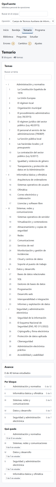
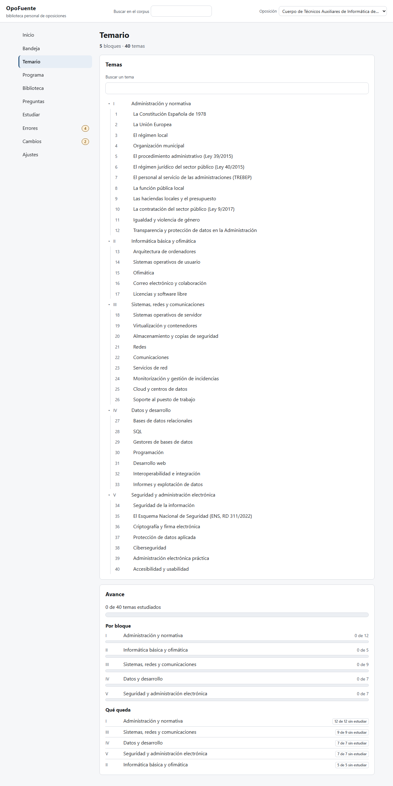
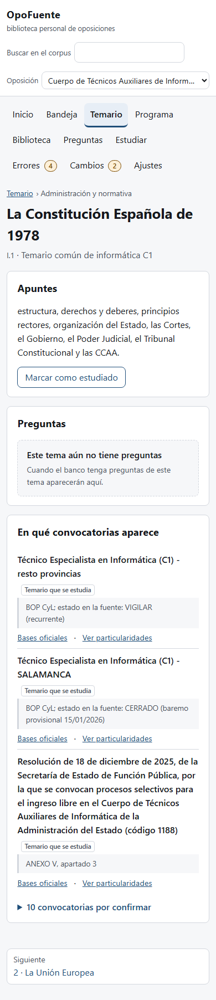
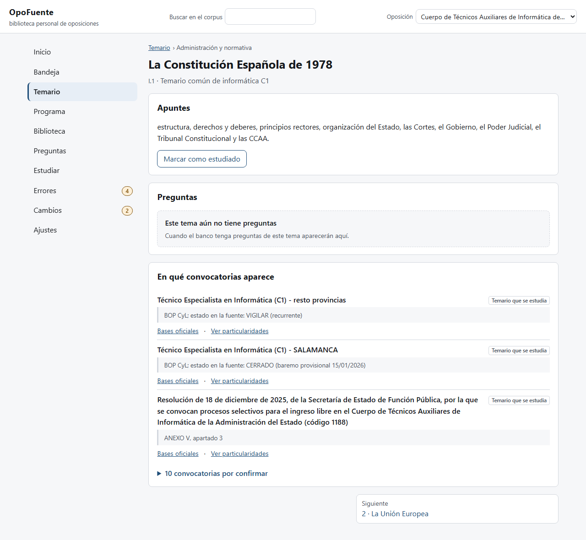

# S13 — temario común y convocatorias que lo referencian

**Estado:** entregado (temario común versionado, referencias por convocatoria, equivalencias TAI →
común, contenido de la ficha, convocatorias C1 importadas, avance y revisión visual).
**Fecha:** 7 de noviembre de 2026.
**Repositorio:** `F:\Proyectos\opofuente`, rama `rescate/fase0-2026-10-26`.
**Datos usados:** ninguno real. Todo se prueba en directorios temporales; la base viva
(`F:\OpoFuente\datos`, revisión 0048 de otra rama) no se ha tocado.

> **Nota de numeración:** este S13 es el que fija el `BACKLOG.md` para el **temario común**.
> `docs/product-spec/11_IMPLEMENTATION-SLICES.md` conserva otra S13 anterior (generación de preguntas
> condicional, fuera del MVP); no es la misma entrega y no se ha tocado.

## Qué he construido

El producto ya sabía **publicar el programa de una convocatoria**; ahora sabe **estudiar un temario
común** y que cada convocatoria lo *referencie* sin copiarlo. En una frase: una sola versión del
temario, N convocatorias que la estudian, y la ficha del tema con lo que hay para estudiarlo y dónde
aparece.

1. **Modelo versionado del temario común** (`curricula` de tipo `common` / `published`,
   `curriculum_versions`, `curriculum_nodes` colgando de la versión, `convocation_curriculum_refs` con
   papeles `primary` / `official` / `complementary`, `convocation_curriculum_adjustments` y
   `curriculum_equivalences`). Migración `0021`, reversible y probada en ambos sentidos.
2. **Contenido v1** generado desde `temario-c1.md` con sha256 en manifiesto: 5 bloques, 40 temas y 45
   nodos (rutas `I.1`…`V.40`); se publica solo si el recuento coincide. El título y sus **apuntes**
   se separan en el fixture (D-024). Si la versión ya está activa, la siembra **no la reescribe**
   (I9).
3. **Siembra idempotente** de perfiles, temario y convocatorias; la referencia `primary` del TAI 2025
   a la v1 se crea/confirma con su cita (O1).
4. **Re-atribución del banco TAI al común** con equivalencias curadas (20 aceptadas, 13 propuestas
   para revisar), informe por fila e inverso probado (B-003).
5. **API del temario**: índice, versiones, avance, temario efectivo por convocatoria (aplica `omitted`
   con su subárbol, `renamed` y `renumbered`), referencias, ficha de nodo con `appears_in`, preguntas
   y material, y marca de estudio (POST/DELETE).
6. **Convocatorias C1 importadas** (B-006): 12 bajo la oposición `informatica-c1` (10 `draft` por
   confirmar y 2 `archived`), con `primary` a la versión activa y su cita; 21 filas del inventario
   descartadas **con motivo escrito**.
7. **Interfaz**: sección «Temario» (árbol 5/40, búsqueda que perdona tildes, marca de estudiado,
   avance por bloque y total) y ficha de tema con apuntes, material enlazado a la biblioteca,
   preguntas enlazadas al banco, «en qué convocatorias aparece» con su estado y enlace a bases o
   anuncio, particularidades y navegación anterior/siguiente.
8. **Limpieza de textos** (§8): fuera el pie con la descripción del producto, el estado interno del
   worker en la cabecera y las etiquetas de nivel redundantes; las convocatorias por confirmar se
   agrupan en un desplegable con una sola nota de procedencia.

## Cómo fluye la información

```text
FUENTES (data/sources, sha256 en fixtures/curricula/manifest.json)
  temario-c1.md ───────────► build_curriculum_fixtures ─► informatica-c1.v1.json (5/40/45)
  c1.txt, convocatorias.csv ► build_c1_convocatorias_fixtures ► convocatorias-c1.json (12 + 21 descartes)
  perfiles oficiales ──────► build_profile_fixtures ─────► fixtures/profiles/*

SIEMBRA (seed_profiles, idempotente)
  fixtures ─► curricula/curriculum_versions/curriculum_nodes (v1)
             └─► convocation_curriculum_refs role=primary (TAI 2025 y C1)
             └─► convocatorias C1 bajo la oposición informatica-c1
             └─► envoltorio published por perfil (programa publicado intacto)

LECTURA
  /curricula/{code} ──► árbol + progreso (marcas y actividad real)
  /convocations/{id}/temario ──► ref primary + ajustes aplicados al vuelo (sin copiar)
  /curriculum-nodes/{id} ──► ficha + appears_in (primary/complementary) + particularidades
  /curriculum-nodes/{id}/questions|materials ──► banco/biblioteca solo con mapeos accepted

ESCRITURA DEL ALUMNO
  POST/DELETE /curriculum-nodes/{id}/studied ──► curriculum_study_marks (fecha)
  El avance se **calcula** al leer; no se guarda ningún porcentaje.
```

La regla que sostiene el dibujo: **la convocatoria referencia, no copia**. Un ajuste (`omitted`,
`renamed`, `renumbered`, `weighted`) vive en la referencia y se aplica al componer; borrar el ajuste
devuelve el temario completo sin tocar la versión.

## Ficheros y migraciones

**Migraciones**

| Migración | Qué hace | Reversión |
|---|---|---|
| `0021_temario_comun_y_referencias` | cinco tablas nuevas; `curriculum_nodes` pasa de `convocation_version_id` a `curriculum_version_id`; referencias, ajustes y equivalencias | probada: vuelve al modelo por convocatoria y comprueba `PRAGMA foreign_key_check` |
| `0022_study_marks` | `curriculum_study_marks` (una fila por nodo, fecha, `ON DELETE CASCADE`) | probada: retira la tabla |

**Dominio y aplicación**

- `domain/curricula.py`, `domain/equivalences.py`, `domain/convocatorias_c1.py`.
- `application/curriculum_service.py`, `curriculum_read_service.py`, `convocatorias_service.py`,
  `curriculum_models.py`, `ports.py`, `read_models.py`.

**Infraestructura y herramientas**

- Repositorios: `curriculum_repository.py`, `curriculum_read_repository.py`,
  `curriculum_lookup.py`, `equivalence_fixture_loader.py`, `remap_repository.py`,
  `convocatorias_fixture_loader.py`, `convocatorias_repository.py`.
- Herramientas: `build_curriculum_fixtures.py`, `build_c1_convocatorias_fixtures.py`,
  `seed_profiles.py`, `remap_curriculum.py`.
- Fixtures: `fixtures/curricula/informatica-c1.v1.json`, `manifest.json`,
  `tai-age-2025.equivalences.json`, `convocatorias-c1.json`.

**API**

`api/routes/temario.py` (+ `api/temario_schemas.py`, `api/profile_schemas.py`, `api/deps.py`,
`main.py`). Rutas: `/curricula`, `/curricula/{code}`, `/curricula/{code}/versions`,
`/curricula/{code}/progress`, `/convocations/{id}/temario`, `/convocations/{id}/references`,
`/curriculum-nodes/{id}`, `/curriculum-nodes/{id}/questions`, `/curriculum-nodes/{id}/materials`,
`/curriculum-nodes/{id}/studied`. `/convocations/{id}/curriculum` sigue devolviendo el programa
**publicado**: no se rompe lo que ya llamaba.

**Interfaz**

`pages/TemarioPage.tsx`, `pages/TemarioNodePage.tsx`, `features/temario/*` (`search.ts`, `labels.ts`,
`TemarioTree.tsx`, `ProgressPanel.tsx`), `api/temario.ts` y hooks de `api/queries.ts`,
`app/navigation.ts`, `app/routes.tsx`, `styles/global.css`. `ProgramPage.tsx` se adaptó al contrato
nuevo (procedencia bajo `convocation`) y perdió textos de desarrollador.

**Pruebas**

`test_migrations_0021.py`, `test_migrations_0022.py`, `test_migrations_downgrade.py`,
`test_temario_comun.py`, `test_equivalencias.py`, `test_temario_api.py`,
`test_temario_contenido_api.py`, `test_convocatorias_c1.py`,
`unit/test_build_curriculum_fixtures.py`, `unit/test_build_c1_convocatorias_fixtures.py`,
`unit/test_remap_curriculum.py`; en la web, `tests/unit/temario.test.tsx` y los ajustes de
`program.test.tsx`, `shell.test.tsx`, `questions.test.tsx` y `testUtils.tsx`.

## Patrones y decisiones aplicadas

| Patrón | Dónde | Por qué |
|---|---|---|
| Referencia con papel, no copia | `convocation_curriculum_refs` (`primary`/`official`/`complementary`) | dos verdades del mismo temario acaban discrepando |
| Ajuste como dato de la referencia | `convocation_curriculum_adjustments` | omitir/renombrar/renumerar es cómo lo ve esa convocatoria, no un cambio del común |
| Versión inmutable una vez activa | siembra (`curriculum_repository`) | I9: no se reescribe lo que ya estudian las convocatorias |
| Cálculo al leer | avance en `curriculum_read_repository` | el porcentaje no envejece ni se convierte en una segunda verdad |
| Fixture con huella y regeneración | `manifest.json` + generadores con `--check` | el contenido versionado es reproducible y se sabe de qué fuente sale |
| Informe por fila e inverso | re-atribución (B-003) | mover datos ajenos exige poder deshacerlo y ver qué se movió |
| Confianza explícita | convocatorias `draft` vs `archived` | un listado sin bases no se presenta como convocatoria confirmada |
| Deep links a biblioteca y banco | ficha (B-016) | el contenido reunido tiene que poder abrirse y usarse |

Decisiones completas: `DECISIONES.md` D-001…D-026. La arquitectura del temario común y de las
referencias está en **ADR-018** (ratificada).

## Seguridad y privacidad

- Nada de la base viva ni de `E:` se ha movido, copiado ni tocado; las pruebas construyen su propio
  árbol en temporales y la puerta 13 migra una base vacía en `.gates-data`.
- La marca de estudiado es dato local del alumno: una fila por nodo, con fecha, sin identidad de
  persona (la instalación es de un solo usuario) y sin salir del árbol de datos.
- Contenido importado es **no confiable**: los listados C1 entran como `draft` con su enlace y una
  cita que dice que no se han verificado bases; no se ejecuta nada de lo importado.
- Procedencia explícita: `source_reference` en referencias y convocatorias; las bases oficiales y el
  anuncio se distinguen en la interfaz.
- Enlaces externos con `target="_blank"` y `rel="noreferrer noopener"`.
- Sin secretos, sin claves, sin tokens en fixtures, pruebas ni interfaz. El contrato no expone la
  clave de las preguntas en la ficha (solo enunciado, tipo y conjunto).

## Puertas ejecutadas y resultado

Ejecutadas sobre `4f9d17f` con `./scripts/gates.ps1 -SkipE2e` (Windows, PowerShell):

| Puerta | Resultado |
|---|---|
| 1–5. formato, lint, mypy estricto, ESLint y TypeScript | verde |
| 6. unitarias backend | **511 passed** |
| 7. integración backend | **484 passed** |
| 8. contrato | **23 passed** |
| 9. componentes (Vitest) | **17 ficheros / 213 pruebas** |
| 10. contrato OpenAPI y tipos sincronizados | verde |
| 11–12. build backend y frontend | verde |
| 13–14. migración desde base vacía y esquema verificado con sqlite3 | revisión `0022`, verde |
| 15–16. siembra desde vacío y segunda siembra idempotente | temario común 5/40/45 y 25 entidades de convocatorias C1; segunda pasada sin cambios |
| 17. fixtures contra sus fuentes | **verde**: temario común y C1 sincronizados; perfiles omitidos con motivo declarado (DEBT-028 cerrada con política falta/drift/ok) |
| 18. E2E (Playwright) | **52 passed** (incluye 3 pruebas del temario: índice, ficha con convocatorias y accesibilidad) |

## Prueba manual

1. Base temporal fuera del repositorio, migrada a `0022` y sembrada con `seed_profiles` (perfiles,
   temario común y convocatorias C1).
2. Contenido de prueba insertado en el árbol temporal (marcas de estudio, preguntas y material
   mapeados a `I.1`) para ver la ficha con datos, no solo los estados vacíos.
3. Revisión automatizada de extremo a extremo a **390×844** y **1280×900** de `/temario` y de la
   ficha del tema, con sus convocatorias C1 enlazadas; las capturas quedan en `docs/capturas/`
   (ver [`LEEME.md`](../capturas/LEEME.md)).
4. Comprobado: `scrollWidth == innerWidth` en índice y ficha (cero scroll horizontal), sin
   solapamientos, con los estados vacíos legibles y sin lenguaje de desarrollo. La ficha de 390 px
   mide 1 805 px de alto y enseña apuntes, preguntas y las 12 convocatorias (2 confirmadas y 10 por
   confirmar).
5. Servidores y navegador cerrados; `.e2e-data` y `test-results` limpios. **No se deja ningún
   servidor ni navegador abierto.**

### Capturas de la revisión (08/11/2026)

| Vista | Móvil 390 px | Escritorio 1280 px |
|---|---|---|
| Índice del temario |  |  |
| Ficha del tema |  |  |

## Limitaciones conocidas

- **La E2E del temario ya existe**: `temario.spec.ts` cubre el índice (5 bloques, 40 temas y
  búsqueda), la ficha con su ruta, el enlace a las convocatorias C1 y la accesibilidad, y mide
  desbordes a 390 y 1280 px. Las capturas de esa prueba son la revisión visual de referencia.
- **DEBT-028 resuelta, con su límite**: si las fuentes oficiales de los perfiles faltan o cambiaron,
  la puerta 17 omite su verificación con el motivo escrito y solo bloquea si se pasa
  `-RequireProfileSources`. Los fixtures de perfiles no se verifican contra fuente en ese caso.
- **B-012 cerrada**: el tema de una propuesta se resuelve dentro de una versión (común activo por
  defecto, ámbito explícito o 409 si hay ambigüedad). El material nuevo se clasifica en el común.
- **La v1 se corrigió antes de existir en una base duradera** (D-024). Si una base ya sembró la v1
  anterior, la siembra se negará a reescribirla (I9) y habrá que publicar una v2 y decidir el
  re-apuntado de referencias; ese flujo de actualización de versión **no está construido**.
- **La ficha depende de mapeos reales**: en una base recién sembrada no hay material ni preguntas
  mapeadas, así que enseña estados vacíos honestos. Poblar biblioteca y banco es de S05/S06/S12.
- **B-006**: solo se importaron 2 filas C1 del inventario (las demás son A1/A2, bolsas o portales) y
  las 10 del agregador son `draft` sin bases verificadas. Las particularidades de las C1 importadas
  están vacías porque no hay bases de las que sacarlas.
- **Base viva**: está en la revisión 0048 de otra rama; esta rama está en `0022`. No se ha migrado
  ni se ha usado para nada de esta entrega.
- El avance se apoya en marcas por `id` de nodo: una versión nueva del temario no hereda las marcas.

## Qué se rompe si cambias X

- **Borrar un nodo con material**: `curriculum_mappings.curriculum_node_id` es `RESTRICT` (ADR-007);
  primero hay que decidir qué pasa con el material. Las marcas de estudio sí caen con el nodo.
- **Editar una versión activa**: la siembra compara el fixture con lo publicado y **falla** con «no se
  edita» (I9). Es a propósito; el camino es versionar.
- **Re-apuntar una referencia `primary` a mano**: cambia lo que estudia una convocatoria sin informe ni
  rastro; el modelo exige decisión y cita (D-010/D-013).
- **Cambiar `path` de los temas**: el TAI se re-atribuyó y las equivalencias se resuelven por `path`;
  renombrar rutas deja equivalencias y material huérfanos de sentido.
- **Tocar el cálculo del avance**: la ficha y la tarjeta de avance comparten la misma consulta; si
  divergen, el árbol y el total dirán cosas distintas.
- **Cambiar `AppearanceSchema`** (estado, enlace, `appears_in`): hay que regenerar contrato y tipos y
  ajustar la ficha; los clientes ya publicados dejan de encajar.
- **Cambiar el significado de `draft`**: la ficha, la importación y la confianza dependen de él; una
  convocatoria sin bases no puede parecer confirmada.

## Qué criticaría un revisor senior

1. **B-017 sigue bloqueada**: el simulacro por bloque exige decidir si es un modo de estudio nuevo o
   una vista del banco; no se ha construido a ciegas. La base (ficha→banco y convocatorias) sí está.
2. **La actualización de versión no está resuelta**: se puede crear una v2 con la siembra, pero no hay
   herramienta para re-apuntar referencias ni para migrar marcas de estudio entre versiones.
3. **B-006 importa listados sin bases**: está marcado `draft`, pero un revisor exigiría un flujo de
   confirmación (con enlace a bases oficiales) antes de considerarlo una convocatoria de verdad.
4. **Las particularidades de las 12 C1 están vacías** porque no hay bases; el modelo las soporta, los
   datos no las tienen todavía.
5. **La fecha de publicación de algunas C1 es la de observación**, no la oficial; está declarado en el
   fixture (`published_at_note`), pero un dato derivado siempre merece una revisión.
6. **La puerta 17 no verifica perfiles si hay drift** (política de DEBT-028): es deliberado y está
   documentado, pero significa que una fuente de perfil cambiada puede pasar sin que nadie la mire.
7. **La corrección de la v1 (D-024)** es defendible solo porque no había base duradera con ella; si
   alguien ya la hubiera sembrado, la decisión habría sido otra.
